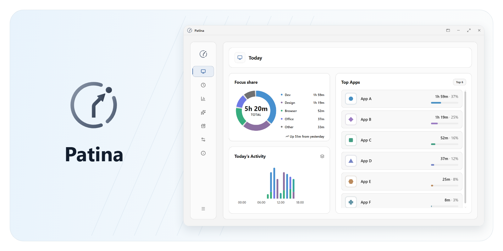
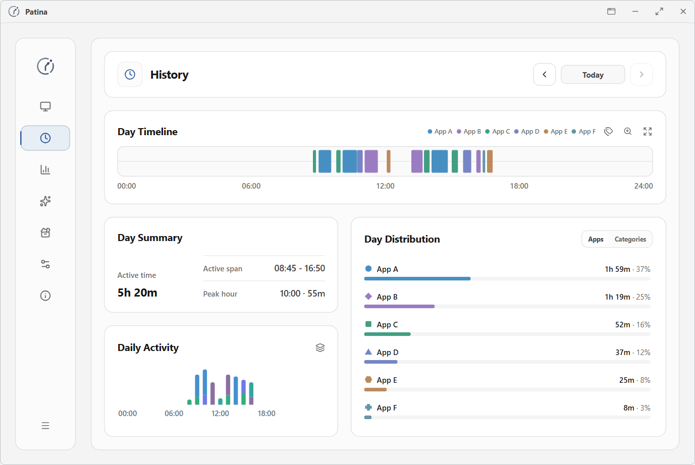
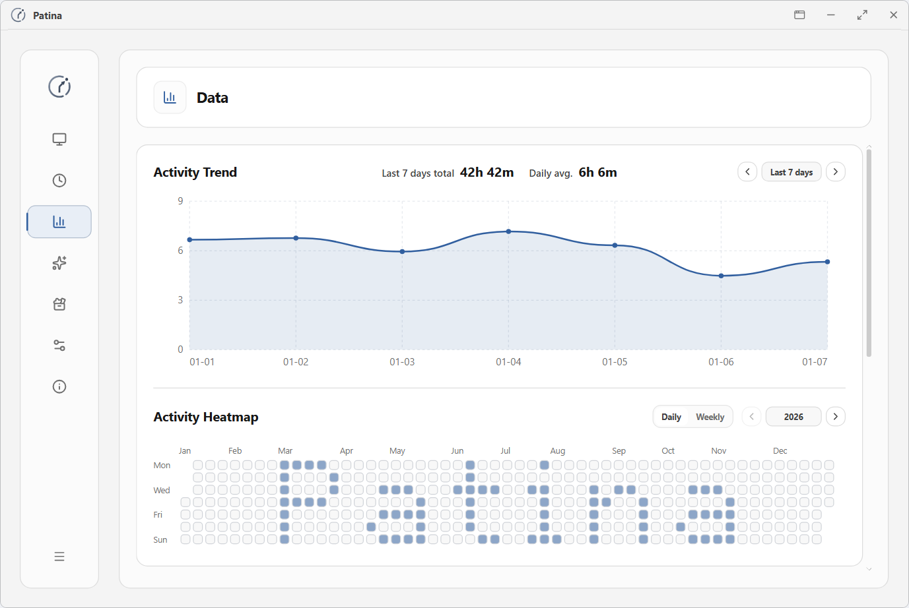
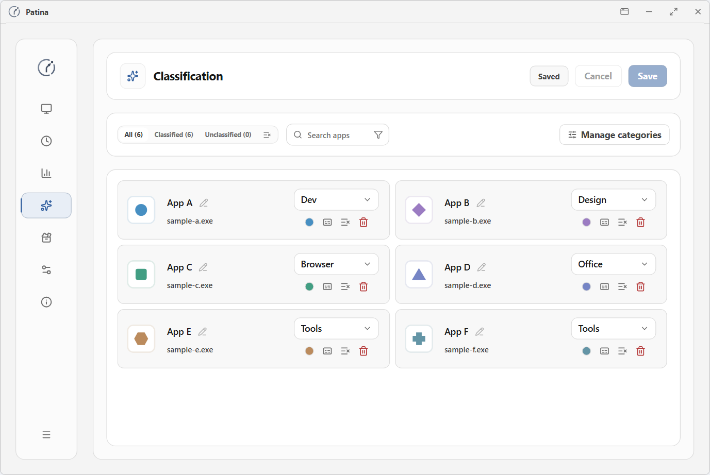
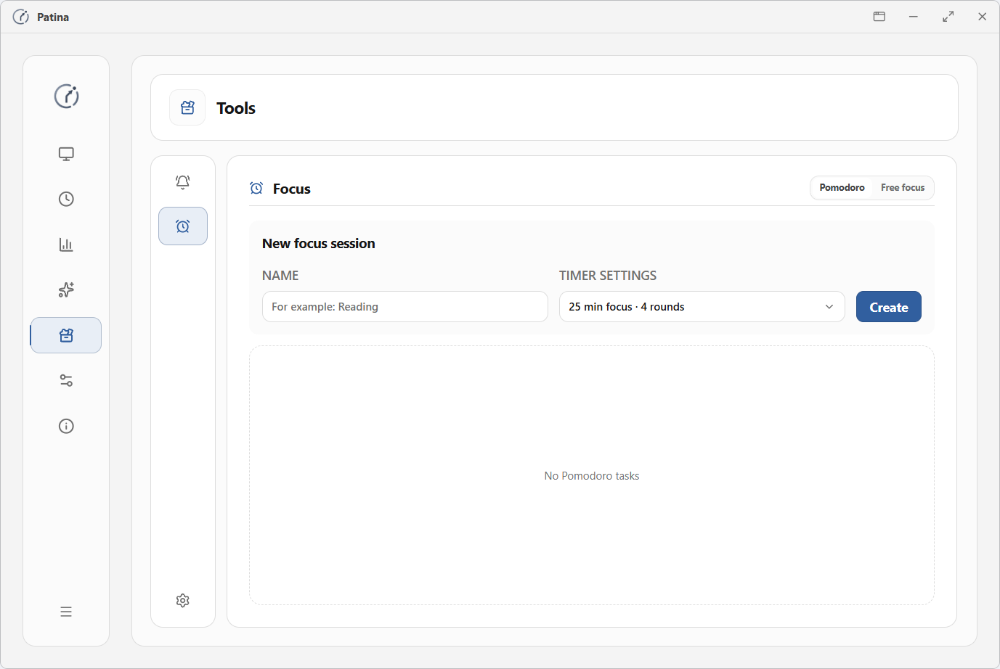
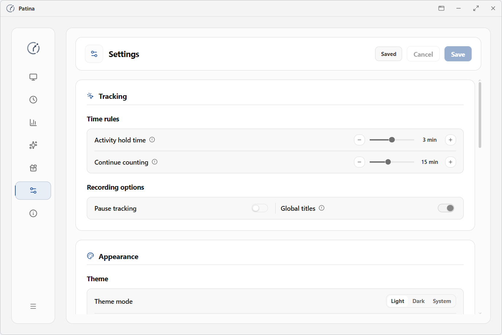
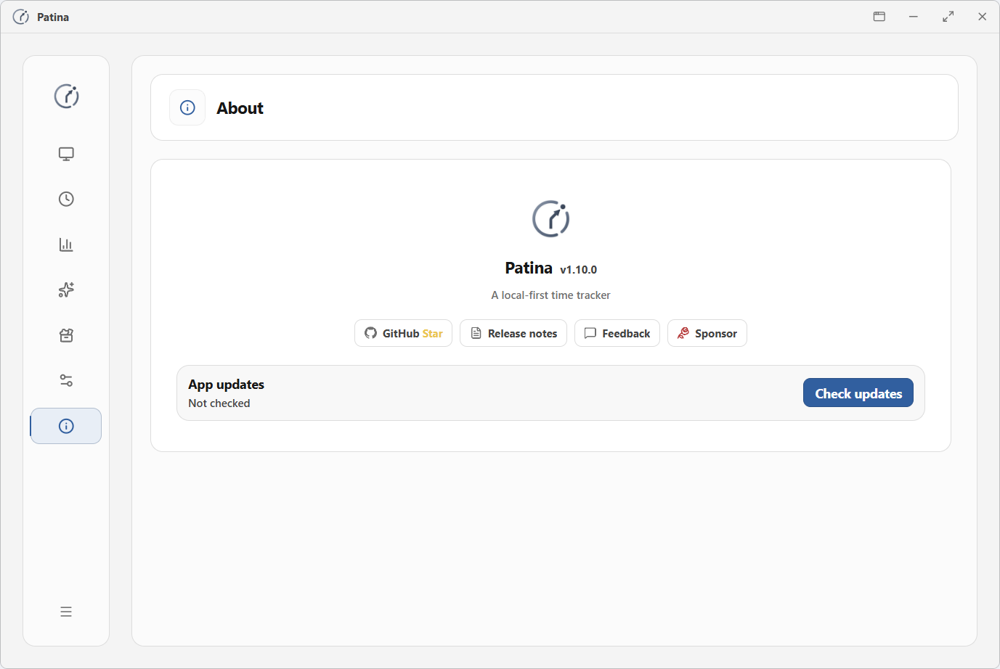
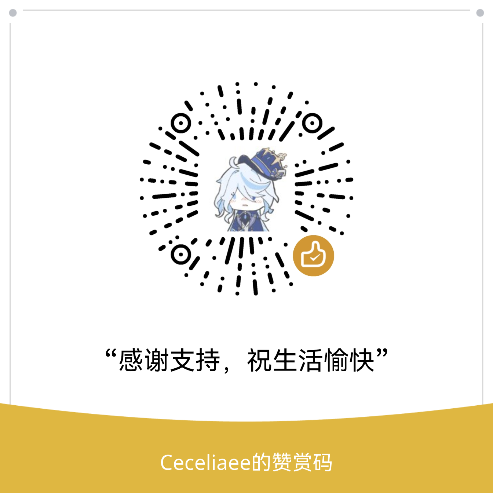

> [!NOTE]
> Patina is migrating its Windows desktop UI to GPUI and plans to use GPUI for future releases. The `main` branch and the [latest stable release](https://github.com/Ceceliaee/patina/releases/latest) still use Tauri. You can keep using your current installation.

# Patina

Quiet, reliable time tracking that keeps your data local.

English · [简体中文](README.zh-CN.md)

  <picture>
    <source media="(prefers-color-scheme: dark)" srcset=".github/assets/readme/hero-dark.png">
    
  </picture>

## Download

Patina runs on Windows 10 and Windows 11.

  <a href="https://github.com/Ceceliaee/patina/releases/latest">
    <picture>
      <source media="(prefers-color-scheme: dark)" srcset=".github/assets/download/patina-download-dark.svg">
      
    </picture>
  </a>

To see browsing time by website, install [Patina Web Sync](https://github.com/Ceceliaee/patina-web-sync) and connect it to the desktop app.

  
  
  

## Why Patina

- Automatically track how much time you spend in each foreground app.
- Review your day, see where your time goes, and follow changes over time.
- Keep activity records on your device by default. No account is required.

## Core Features

### Automatic Tracking

- Record each period of activity in the foreground app.
- Keep tracking during videos and meetings using signals such as audio playback.

### Review and Analysis

- See daily activity totals, your most-used apps, and the share of time spent in each category.
- Browse by date to review app switches and saved window titles.
- Compare app usage trends and see how your time is distributed across different periods.

### Management and Control

- Customize display names, categories, and colors for apps and websites.
- Combine usage time for related programs. Websites are grouped by their main domain.
- Back up data locally or to WebDAV, schedule backups, and restore from a backup.
- Import or export activity records.

### Lightweight Tools

- Schedule one-time or recurring reminders.
- Set daily limits for apps, categories, or websites and get a reminder when you reach a limit.
- Use Pomodoro or free focus and review focus sessions and breaks by task.

## Interface Preview

<table>
  <tr>
    <td width="50%" align="center"><strong>History</strong></td>
    <td width="50%" align="center"><strong>Data</strong></td>
  </tr>
  <tr>
    <td width="50%">
      <picture>
        <source media="(prefers-color-scheme: dark)" srcset=".github/assets/readme/history-dark.png">
        
      </picture>
    </td>
    <td width="50%">
      <picture>
        <source media="(prefers-color-scheme: dark)" srcset=".github/assets/readme/data-dark.png">
        
      </picture>
    </td>
  </tr>
  <tr>
    <td width="50%" align="center"><strong>Classification</strong></td>
    <td width="50%" align="center"><strong>Tools</strong></td>
  </tr>
  <tr>
    <td width="50%">
      <picture>
        <source media="(prefers-color-scheme: dark)" srcset=".github/assets/readme/classification-dark.png">
        
      </picture>
    </td>
    <td width="50%">
      <picture>
        <source media="(prefers-color-scheme: dark)" srcset=".github/assets/readme/tools-dark.png">
        
      </picture>
    </td>
  </tr>
  <tr>
    <td width="50%" align="center"><strong>Settings</strong></td>
    <td width="50%" align="center"><strong>About</strong></td>
  </tr>
  <tr>
    <td width="50%">
      <picture>
        <source media="(prefers-color-scheme: dark)" srcset=".github/assets/readme/settings-dark.png">
        
      </picture>
    </td>
    <td width="50%">
      <picture>
        <source media="(prefers-color-scheme: dark)" srcset=".github/assets/readme/about-dark.png">
        
      </picture>
    </td>
  </tr>
</table>

## Reliability and Privacy

- **Idle detection.** Patina distinguishes active time from periods of inactivity, screen lock, and sleep.
- **Active time.** App rankings, category shares, and totals use time spent active.
- **Title recording and anonymous statistics.** Choose whether to save titles for each app or website, or enable [anonymous statistics](docs/product-principles-and-scope.md#73-可管理的应用语义层).
- **Browsing privacy.** Web records store full URLs locally by default. Anonymous statistics retain only browsing time.
- **History retention.** Clear activity records older than the retention period you choose.

## Feedback

Report problems or suggest improvements through GitHub Issues or the Patina QQ channel.

  <a href="https://github.com/Ceceliaee/patina/issues/new/choose">
    <picture>
      <source media="(prefers-color-scheme: dark)" srcset=".github/assets/feedback/github-issues-button-dark.svg">
      
    </picture>
  </a>
    
  <picture>
    <source media="(prefers-color-scheme: dark)" srcset=".github/assets/feedback/qq-channel-dark.jpg">
    
  </picture>

## Development and Contributing

### Run from Source

Follow the [first-run guide](CONTRIBUTING.md#34-install-dependencies) to set up the development environment and install dependencies, then run `pnpm run tauri dev`. The development build can run alongside the release build. Each uses its own data directory. To build a release installer, see the [release policy](docs/versioning-and-release-policy.md#10-发布前的最低验证门槛).

### Tech Stack

- **Desktop framework** — Tauri v2
- **Backend** — Rust
- **System integration** — Windows API
- **Frontend** — React and TypeScript
- **Styling** — Tailwind CSS
- **Frontend build tool** — Vite
- **Local storage** — SQLite

### Contributing

The [contributing guide](CONTRIBUTING.md#english) explains how to discuss the scope of a change, validate it, and submit a pull request.

## Support the Project

If Patina has been useful to you, you can support its maintenance through Ko-fi or WeChat.

  
    
  <picture>
    <source media="(prefers-color-scheme: dark)" srcset=".github/assets/support/wechat-reward-dark.png">
    
  </picture>

## Star History

<a href="https://www.star-history.com/?repos=Ceceliaee%2Fpatina">
 <picture>
   <source media="(prefers-color-scheme: dark)" srcset="https://api.star-history.com/chart?repos=Ceceliaee/patina&type=date&theme=dark&legend=top-left&sealed_token=TkOqzStKb8XlqP6BGjPQemnL7ZceKzqtuxfJf7xf_DrzNfgZeW2TjJDSbHigf23UNcY-30x56ZaebW5RV1tbcW2Q_5UczdmmdB2ndfELHsoLcpYL5hIHvw" />
   <source media="(prefers-color-scheme: light)" srcset="https://api.star-history.com/chart?repos=Ceceliaee/patina&type=date&legend=top-left&sealed_token=TkOqzStKb8XlqP6BGjPQemnL7ZceKzqtuxfJf7xf_DrzNfgZeW2TjJDSbHigf23UNcY-30x56ZaebW5RV1tbcW2Q_5UczdmmdB2ndfELHsoLcpYL5hIHvw" />
   
 </picture>
</a>

## License

[MIT](LICENSE)
