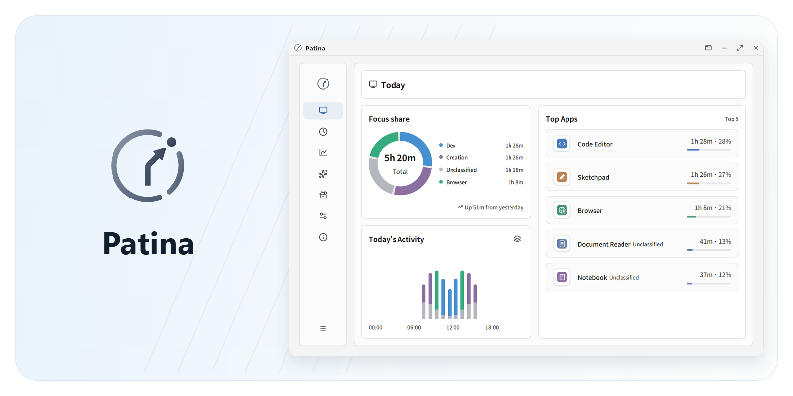
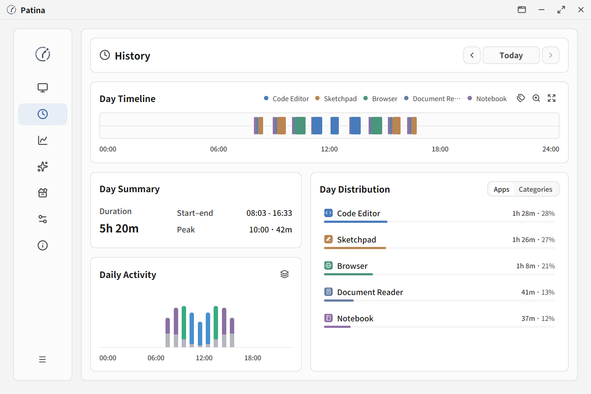
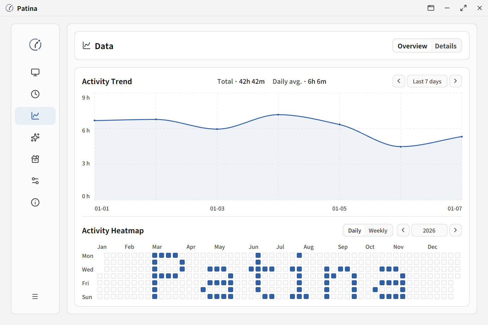
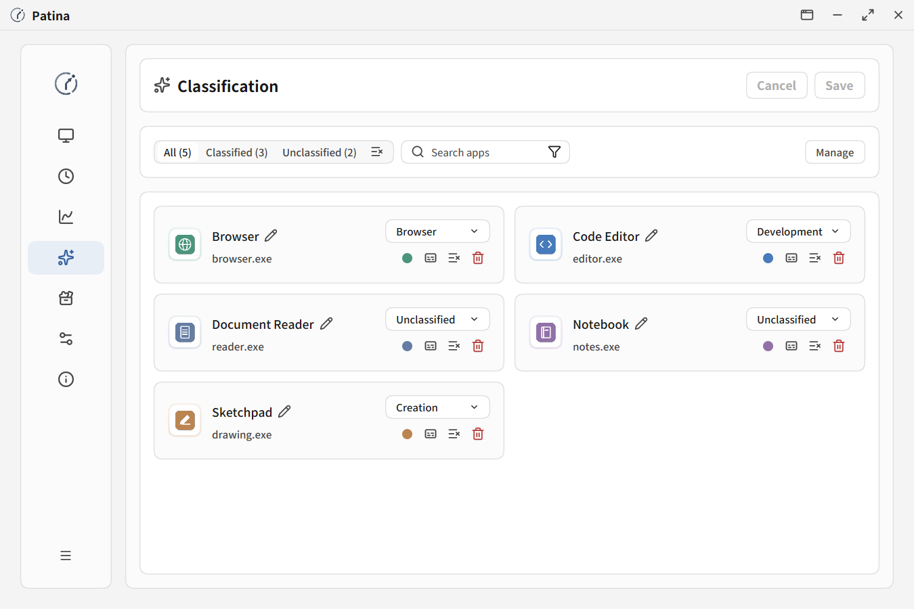
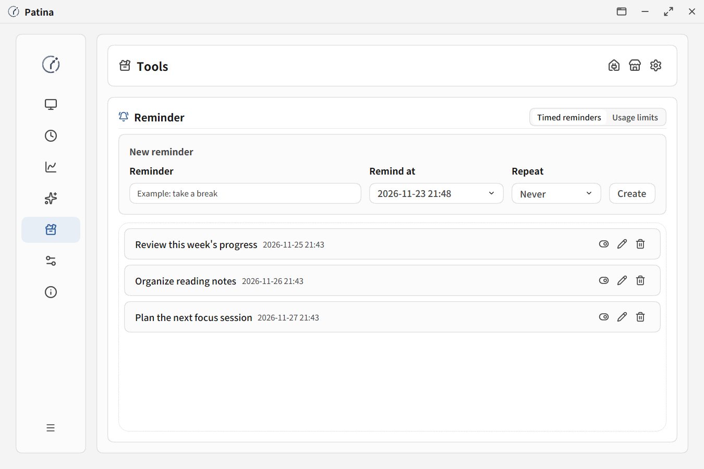
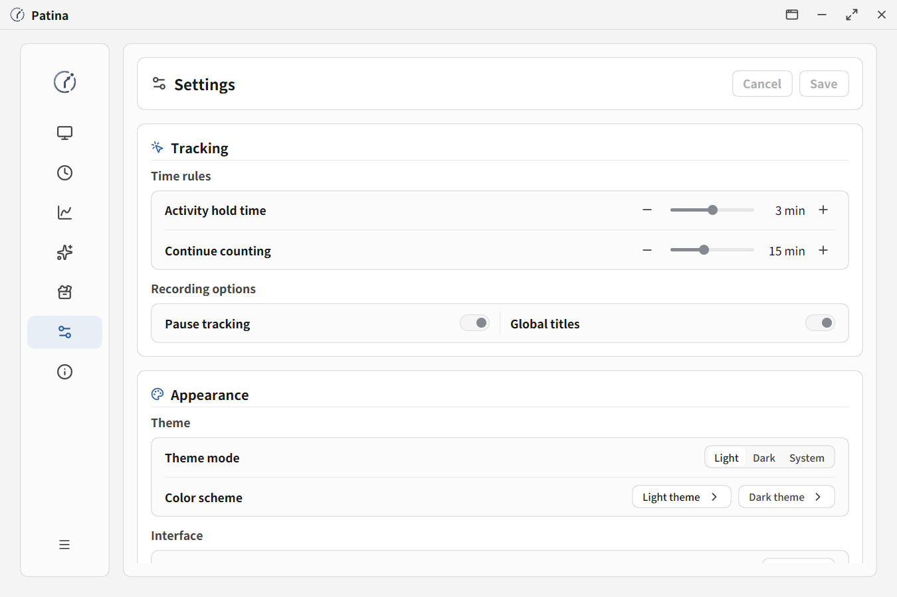
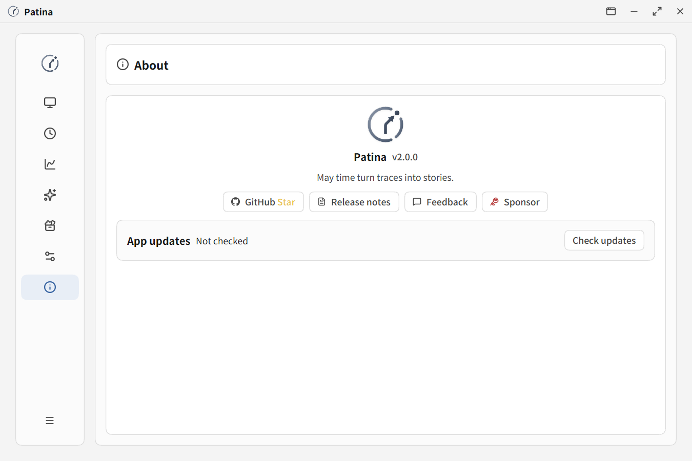
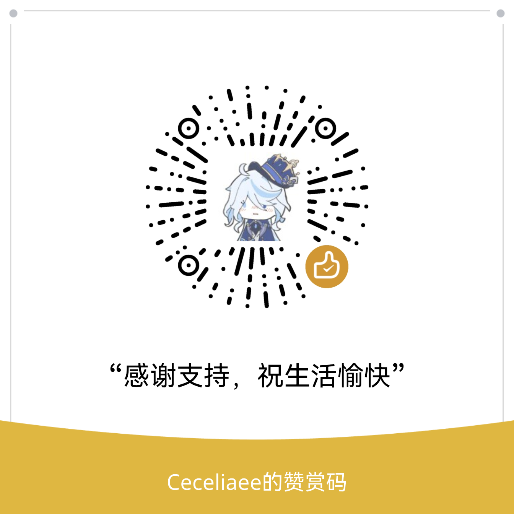

# Patina

Quiet, reliable time tracking that keeps your data local.

English · [简体中文](README.zh-CN.md)

  <picture>
    <source media="(prefers-color-scheme: dark)" srcset=".github/assets/readme/hero-dark.png">
    
  </picture>

## Download

Patina runs on Windows 10 and 11. For a first install, choose **x64** for a 64-bit Intel or AMD PC, or **ARM64** for an ARM PC.

  <a href="https://github.com/Ceceliaee/patina/releases/latest">
    <picture>
      <source media="(prefers-color-scheme: dark)" srcset=".github/assets/download/patina-download-dark.svg">
      
    </picture>
  </a>

### Browser Extension

To see browsing time by website, install the [Patina Web Sync](https://github.com/Ceceliaee/patina-web-sync) browser extension and connect it to the desktop app.

  
  
  

## Why Patina

- Automatically track how much time you spend in each foreground app.
- Review your day, see where your time goes, and follow changes over time.
- Keep activity records on your device by default. Track and review your time offline without an account.

## Core Features

### Automatic Tracking

- Record each period of activity in the foreground app.
- Keep tracking during videos and meetings using signals such as audio playback.
- Keep tracking from the system tray after closing the main window.
- The mini window shows your current activity, a timeline of the past hour, and tool timers.

### Review and Analysis

- See daily activity totals, your most-used apps, and the share of time spent in each category.
- Browse by date to review app switches and saved window titles.
- Compare app usage trends and see how your time is distributed across different periods.

### Management and Control

- Customize display names, categories, and colors for apps and websites.
- Combine usage time for related programs. Websites are grouped by their main domain.
- Back up data locally or to your own WebDAV server, schedule backups, and restore from a backup.
- Import or export activity records.

### Plugin Store

Both plugins in the store are free and come preinstalled.

- **Reminder** lets you schedule one-time or recurring reminders. It can also alert you when you reach a daily limit for an app, category, or website.
- **Focus** offers Pomodoro and Free focus modes. Review your sessions and breaks by task.

Open **Tools → Plugin store** to manage plugins or install one from a local ZIP file.

## Interface Preview

<table>
  <tr>
    <td width="50%" align="center"><strong>History</strong></td>
    <td width="50%" align="center"><strong>Data</strong></td>
  </tr>
  <tr>
    <td width="50%">
      <picture>
        <source media="(prefers-color-scheme: dark)" srcset=".github/assets/readme/history-dark.png">
        
      </picture>
    </td>
    <td width="50%">
      <picture>
        <source media="(prefers-color-scheme: dark)" srcset=".github/assets/readme/data-dark.png">
        
      </picture>
    </td>
  </tr>
  <tr>
    <td width="50%" align="center"><strong>Classification</strong></td>
    <td width="50%" align="center"><strong>Tools</strong></td>
  </tr>
  <tr>
    <td width="50%">
      <picture>
        <source media="(prefers-color-scheme: dark)" srcset=".github/assets/readme/classification-dark.png">
        
      </picture>
    </td>
    <td width="50%">
      <picture>
        <source media="(prefers-color-scheme: dark)" srcset=".github/assets/readme/tools-dark.png">
        
      </picture>
    </td>
  </tr>
  <tr>
    <td width="50%" align="center"><strong>Settings</strong></td>
    <td width="50%" align="center"><strong>About</strong></td>
  </tr>
  <tr>
    <td width="50%">
      <picture>
        <source media="(prefers-color-scheme: dark)" srcset=".github/assets/readme/settings-dark.png">
        
      </picture>
    </td>
    <td width="50%">
      <picture>
        <source media="(prefers-color-scheme: dark)" srcset=".github/assets/readme/about-dark.png">
        
      </picture>
    </td>
  </tr>
</table>

## Reliability and Privacy

- **Active time.** Totals exclude time spent idle, locked, or asleep.
- **Title recording.** Turn off title recording for individual apps or websites.
- **URLs.** Web Sync saves full URLs by default, including paths and query parameters.
- **[Anonymous tracking](docs/product.md#身份隐私与历史).** Enable it for an app or website to keep only the timing and duration of new activity.
- **History cleanup.** In Settings, choose a cutoff date to delete old activity records.

## Feedback

Report problems or suggest improvements through GitHub Issues or the Patina QQ channel.

  <a href="https://github.com/Ceceliaee/patina/issues/new/choose">
    <picture>
      <source media="(prefers-color-scheme: dark)" srcset=".github/assets/feedback/github-issues-button-dark.svg">
      
    </picture>
  </a>
    
  <picture>
    <source media="(prefers-color-scheme: dark)" srcset=".github/assets/feedback/qq-channel-dark.jpg">
    
  </picture>

## Development and Contributing

### Run from Source

Follow the [first-run guide](CONTRIBUTING.md#34-install-dependencies) to set up the development environment and install dependencies, then run `cargo xtask dev`. The development build can run alongside the release build. Each uses its own data directory. To build a release installer, see the [Windows packaging instructions](docs/release.md#windows-安装与更新).

### Tech Stack

- Desktop framework: GPUI
- Language: Rust
- System integration: Windows API
- UI components: Quiet Pro
- Local storage: SQLite

### Contributing

The [contributing guide](CONTRIBUTING.md#english) explains how to discuss the scope of a change, validate it, and submit a pull request.

## Support the Project

If Patina has been useful to you, you can support its maintenance through Ko-fi or WeChat.

  
    
  <picture>
    <source media="(prefers-color-scheme: dark)" srcset=".github/assets/support/wechat-reward-dark.png">
    
  </picture>

## Star History

<a href="https://www.star-history.com/?repos=Ceceliaee%2Fpatina">
 <picture>
   <source media="(prefers-color-scheme: dark)" srcset="https://api.star-history.com/chart?repos=Ceceliaee/patina&type=date&theme=dark&legend=top-left&sealed_token=TkOqzStKb8XlqP6BGjPQemnL7ZceKzqtuxfJf7xf_DrzNfgZeW2TjJDSbHigf23UNcY-30x56ZaebW5RV1tbcW2Q_5UczdmmdB2ndfELHsoLcpYL5hIHvw" />
   <source media="(prefers-color-scheme: light)" srcset="https://api.star-history.com/chart?repos=Ceceliaee/patina&type=date&legend=top-left&sealed_token=TkOqzStKb8XlqP6BGjPQemnL7ZceKzqtuxfJf7xf_DrzNfgZeW2TjJDSbHigf23UNcY-30x56ZaebW5RV1tbcW2Q_5UczdmmdB2ndfELHsoLcpYL5hIHvw" />
   
 </picture>
</a>

## License

[MIT](LICENSE)
