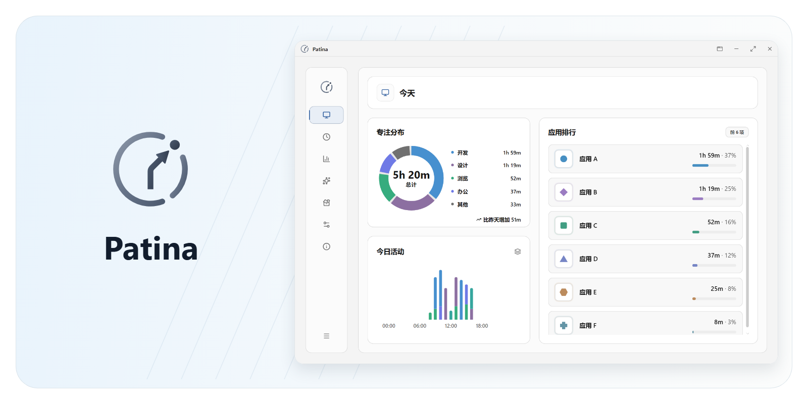
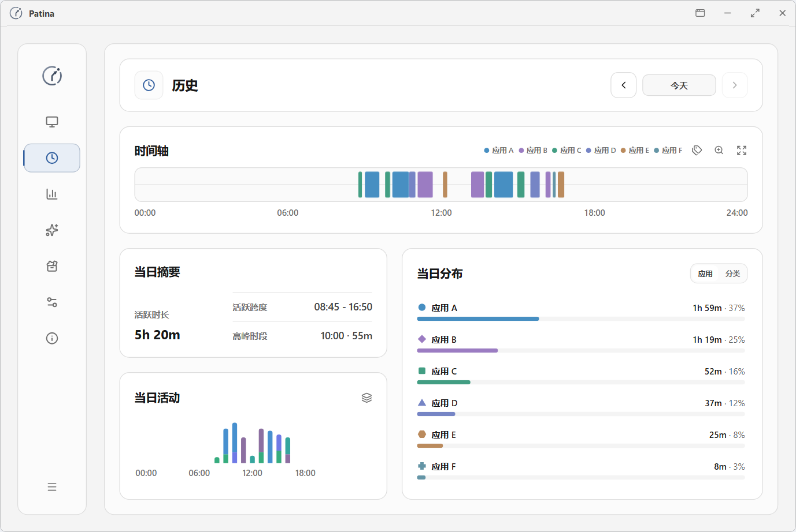
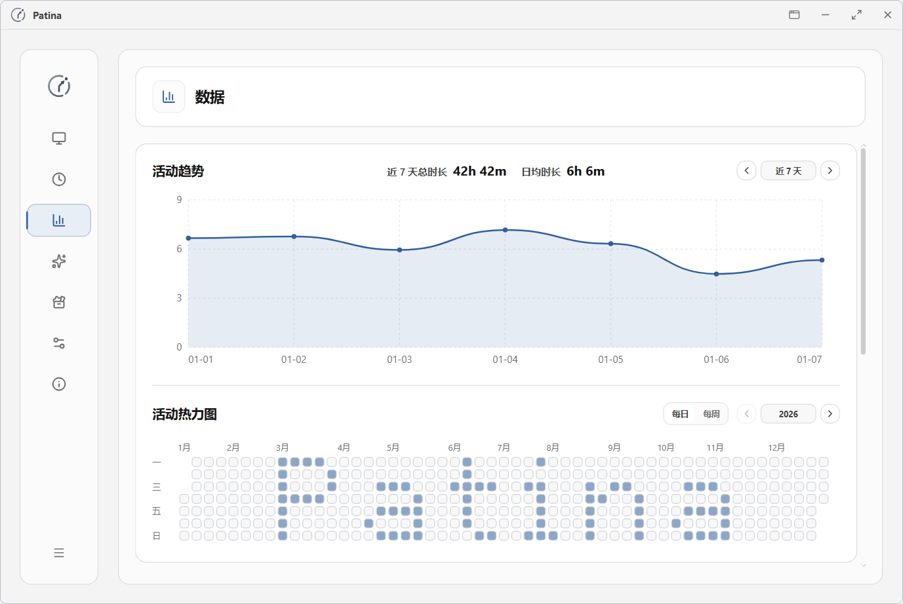
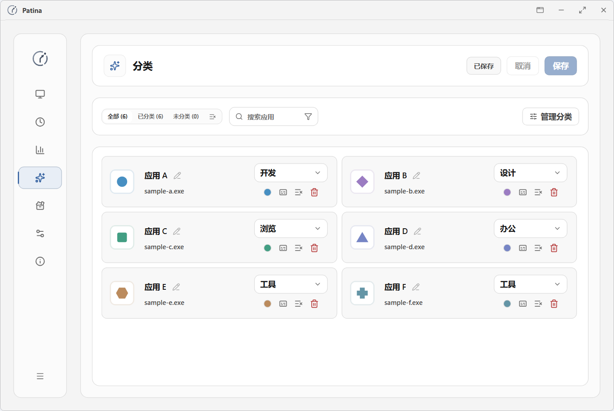
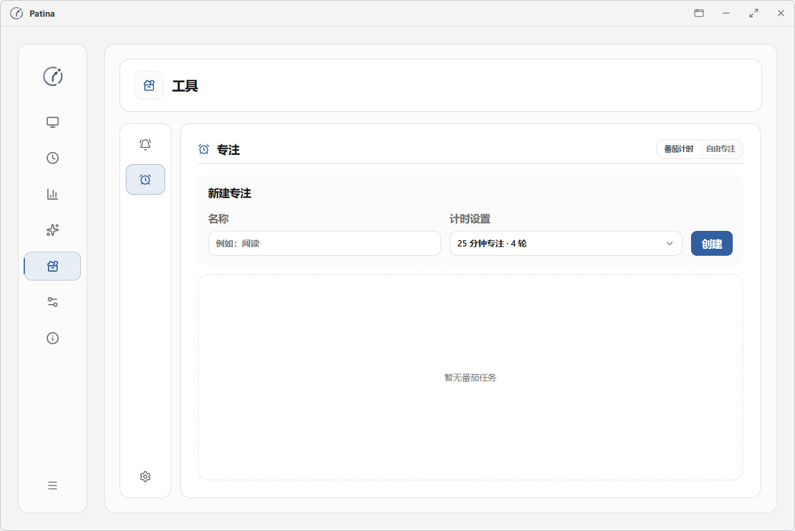
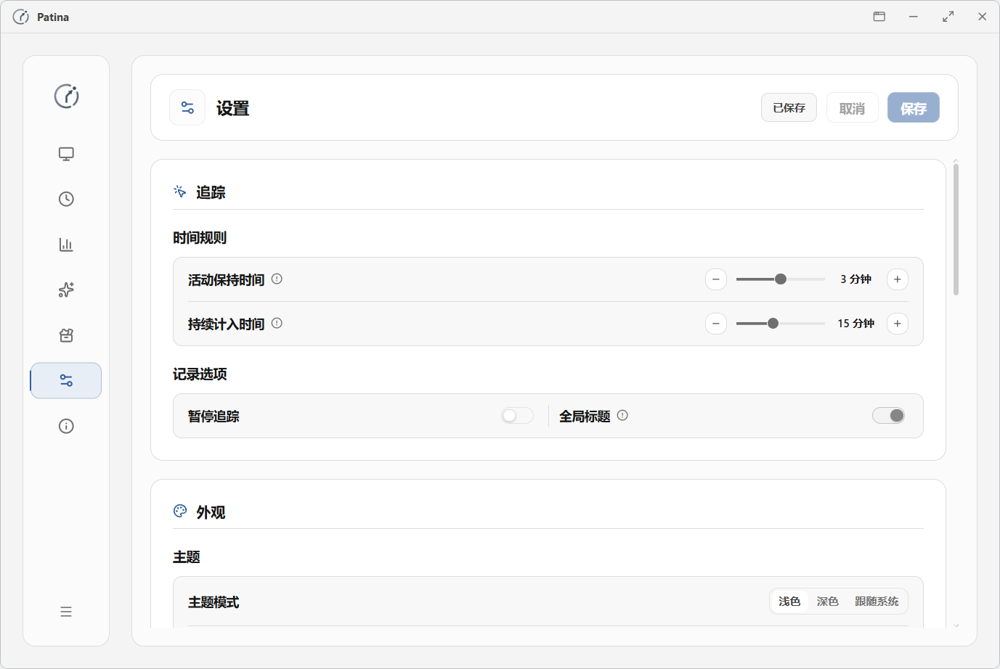
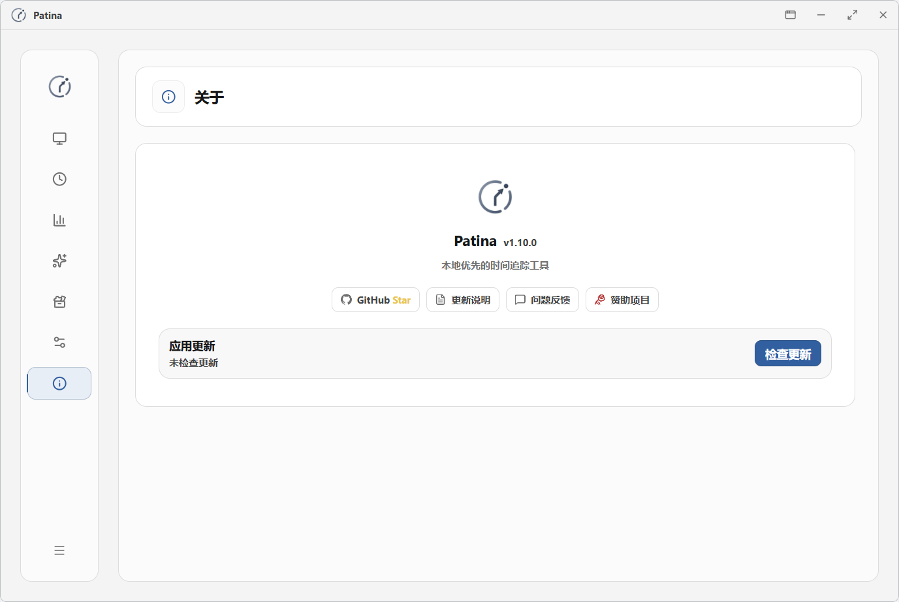
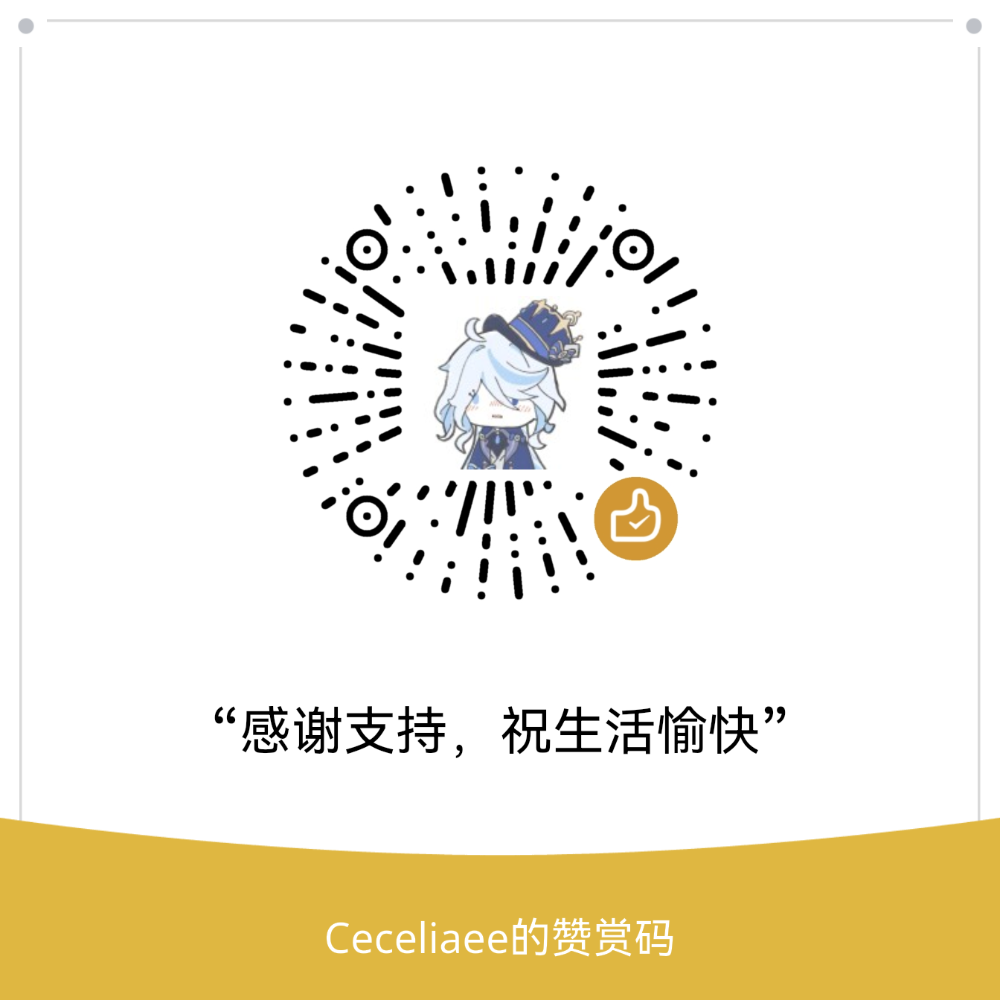

> [!NOTE]
> Patina 正在将 Windows 桌面界面迁移到 GPUI，计划在后续版本中采用 GPUI 作为桌面 UI 框架。目前 `main` 分支和[最新稳定版](https://github.com/Ceceliaee/patina/releases/latest)仍使用 Tauri，已安装的用户可以照常使用。

# Patina

本地、安静、可信的时间追踪工具

[English](README.md) · 简体中文

  <picture>
    <source media="(prefers-color-scheme: dark)" srcset=".github/assets/readme.zh-CN/hero-dark.png">
    
  </picture>

## 下载

桌面端适用于 Windows 10 和 Windows 11。

  <a href="https://github.com/Ceceliaee/patina/releases/latest">
    <picture>
      <source media="(prefers-color-scheme: dark)" srcset=".github/assets/download/patina-download-dark.svg">
      
    </picture>
  </a>

如需按网站查看浏览时间，可安装浏览器扩展 [Patina Web Sync](https://github.com/Ceceliaee/patina-web-sync) 并连接桌面端。

  
  
  

## 为什么选择 Patina

- 自动追踪前台应用，记录各应用的使用时长。
- 回顾每日应用使用情况，了解时间分布及长期变化。
- 活动记录默认保存在本机，无需账号即可使用。

## 核心能力

### 自动追踪

- 识别前台应用，按使用时段记录活动。
- 播放视频或参加会议时，可根据音频等持续活动信号继续计时。

### 回看与分析

- 查看当日活动时长、应用排行及各类应用的时间占比。
- 按日期回看应用切换记录及已保存的窗口标题。
- 查看不同时期的活动分布，比较各应用的使用趋势。

### 管理与控制

- 自定义应用和网站的显示名称、分类与颜色。
- 合并统计关联程序的使用时长，网站按主域名自动分组。
- 将数据备份到本机或 WebDAV，支持定时备份和从备份恢复。
- 导入或导出活动记录。

### 轻量工具

- 设置定时提醒，可提醒一次或按周期重复。
- 为应用、分类或网站设置每日使用上限，达到上限时发出提醒。
- 使用番茄计时或自由专注，按任务回顾专注与休息记录。

## 界面预览

<table>
  <tr>
    <td width="50%" align="center"><strong>历史</strong></td>
    <td width="50%" align="center"><strong>数据</strong></td>
  </tr>
  <tr>
    <td width="50%">
      <picture>
        <source media="(prefers-color-scheme: dark)" srcset=".github/assets/readme.zh-CN/history-dark.png">
        
      </picture>
    </td>
    <td width="50%">
      <picture>
        <source media="(prefers-color-scheme: dark)" srcset=".github/assets/readme.zh-CN/data-dark.png">
        
      </picture>
    </td>
  </tr>
  <tr>
    <td width="50%" align="center"><strong>分类</strong></td>
    <td width="50%" align="center"><strong>工具</strong></td>
  </tr>
  <tr>
    <td width="50%">
      <picture>
        <source media="(prefers-color-scheme: dark)" srcset=".github/assets/readme.zh-CN/classification-dark.png">
        
      </picture>
    </td>
    <td width="50%">
      <picture>
        <source media="(prefers-color-scheme: dark)" srcset=".github/assets/readme.zh-CN/tools-dark.png">
        
      </picture>
    </td>
  </tr>
  <tr>
    <td width="50%" align="center"><strong>设置</strong></td>
    <td width="50%" align="center"><strong>关于</strong></td>
  </tr>
  <tr>
    <td width="50%">
      <picture>
        <source media="(prefers-color-scheme: dark)" srcset=".github/assets/readme.zh-CN/settings-dark.png">
        
      </picture>
    </td>
    <td width="50%">
      <picture>
        <source media="(prefers-color-scheme: dark)" srcset=".github/assets/readme.zh-CN/about-dark.png">
        
      </picture>
    </td>
  </tr>
</table>

## 可靠性与隐私

- **空闲识别**：识别长时间无操作、锁屏和睡眠状态，区分活动与空闲时段。
- **有效时长统计**：按有效活动时间计算应用排行、分类占比和总时长。
- **标题记录与匿名统计**：可按应用或网站选择是否保存标题，或为其启用[匿名统计](docs/product-principles-and-scope.md#73-可管理的应用语义层)。
- **网页记录隐私**：网页记录默认在本机保存完整网址，启用匿名统计后仅记录浏览时长。
- **历史记录清理**：可按保留期限清理历史活动记录。

## 反馈

欢迎通过 GitHub Issues 或 QQ 频道反馈问题、提出建议。

  <a href="https://github.com/Ceceliaee/patina/issues/new/choose">
    <picture>
      <source media="(prefers-color-scheme: dark)" srcset=".github/assets/feedback/github-issues-button-dark.svg">
      
    </picture>
  </a>
    
  <picture>
    <source media="(prefers-color-scheme: dark)" srcset=".github/assets/feedback/qq-channel-dark.jpg">
    
  </picture>

## 开发与贡献

### 从源码运行

按[首次运行指南](CONTRIBUTING.md#34-安装依赖)配置开发环境、安装依赖，再运行 `pnpm run tauri dev` 启动开发版。开发版可与正式版同时运行，两者使用独立的数据目录。构建正式安装包请参阅[发布规范](docs/versioning-and-release-policy.md#10-发布前的最低验证门槛)。

### 技术栈

- 桌面框架：Tauri v2
- 后端开发：Rust
- 系统集成：Windows API
- 前端开发：React、TypeScript
- 界面样式：Tailwind CSS
- 前端构建：Vite
- 本地存储：SQLite

### 贡献

参与开发前，请阅读[贡献指南](CONTRIBUTING.md#zh-cn)，了解如何讨论改动范围、验证修改和提交 Pull Request。

## 支持项目

如果 Patina 对你有帮助，欢迎通过 Ko-fi 或微信赞赏支持项目维护。

  
    
  <picture>
    <source media="(prefers-color-scheme: dark)" srcset=".github/assets/support/wechat-reward-dark.png">
    
  </picture>

## Star History

<a href="https://www.star-history.com/?repos=Ceceliaee%2Fpatina">
 <picture>
   <source media="(prefers-color-scheme: dark)" srcset="https://api.star-history.com/chart?repos=Ceceliaee/patina&type=date&theme=dark&legend=top-left&sealed_token=TkOqzStKb8XlqP6BGjPQemnL7ZceKzqtuxfJf7xf_DrzNfgZeW2TjJDSbHigf23UNcY-30x56ZaebW5RV1tbcW2Q_5UczdmmdB2ndfELHsoLcpYL5hIHvw" />
   <source media="(prefers-color-scheme: light)" srcset="https://api.star-history.com/chart?repos=Ceceliaee/patina&type=date&legend=top-left&sealed_token=TkOqzStKb8XlqP6BGjPQemnL7ZceKzqtuxfJf7xf_DrzNfgZeW2TjJDSbHigf23UNcY-30x56ZaebW5RV1tbcW2Q_5UczdmmdB2ndfELHsoLcpYL5hIHvw" />
   
 </picture>
</a>

## 许可证

[MIT](LICENSE)
