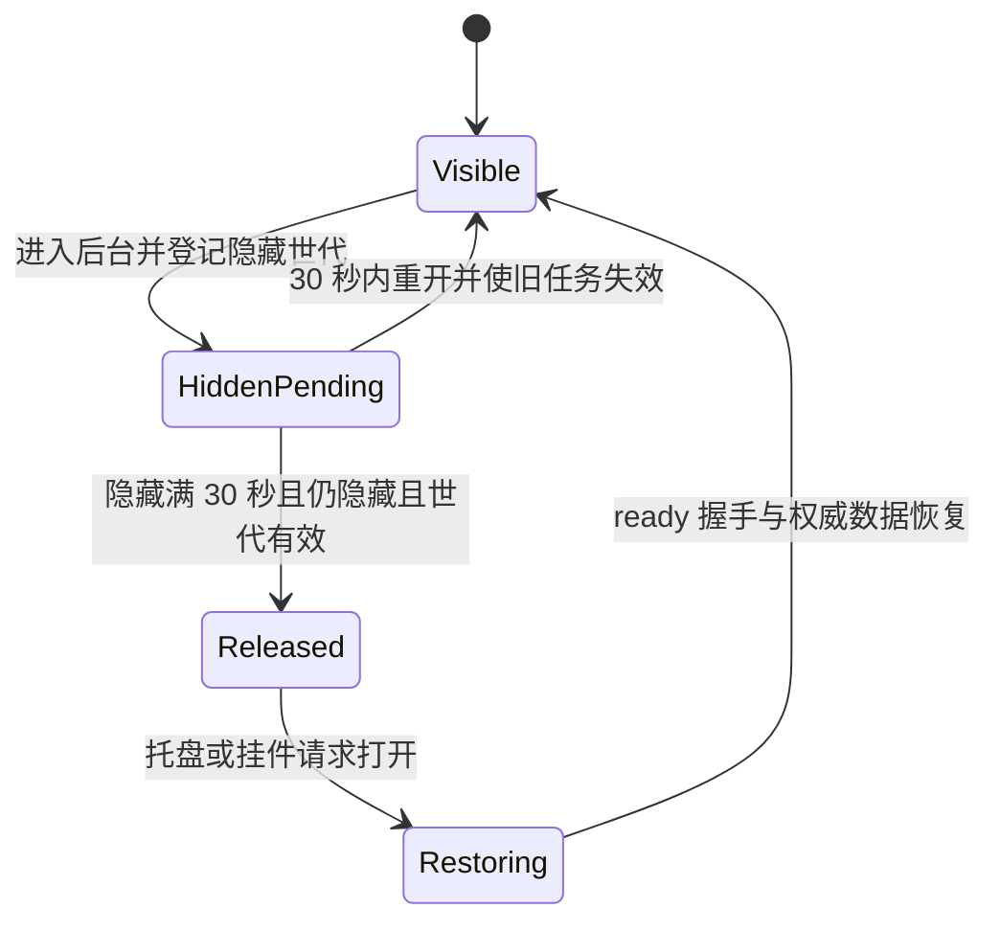

# 固定启用低耗后台并移除设置选项执行方案

> 状态：源码实施及适用验证完成；安装与人工系统场景已转交原方案，本文归档
> 创建 / 更新：2026-10-24
> 执行 owner：本任务执行者；代码责任按第 4 节划分
> 承接事项：[后台运行可靠性整改记录](2026-10-17-background-runtime-reliability-plan.md) P7-11；关联任务已结束，后续安排以其归档结论为准
> 本次交付：实现、验证、勾选归档及实施后的对抗式审查；安装交付按 G 阶段明确承接

## 1. 结果与范围

将现有低耗后台作为固定运行行为：主窗口进入适用的隐藏状态后，销毁等待从三分钟缩短为 **30 秒**；到期且仍满足可见性、隐藏世代等保护条件时释放可重建的界面资源，再次打开时通过现有窗口生命周期恢复界面。设置页移除“低耗后台”开关、说明和可访问性入口。

新安装、升级、旧配置读取、备份覆盖恢复和合并恢复必须得到一致结果。即使数据库仍包含 `background_optimization=0`，也不能关闭这项策略。这里的“固定启用”不改变开机自启动、静默启动、关闭到托盘、显示托盘图标或最小化到挂件的用户选择。

本任务将主窗口销毁与前端页面缓存清理的等待均调整为 30 秒，两者分别检查适用的后台状态。主窗口销毁时，其 WebView 内存随窗口释放，无需等待缓存 timer 先执行。不新增 WebView 挂起方案，不重构 tracking、备份格式或窗口恢复框架。数据页布局修复和发布摘要长度调整是当前工作树中的其他已授权修改，实施时保留，不混入本项验收结论。

长期边界由[架构](../architecture.md)、[工程质量](../engineering-quality.md)、[Quiet Pro](../quiet-pro-component-guidelines.md)、[本地化](../localization.md)和[发布规范](../versioning-and-release-policy.md)持有；本文只拥有 P7-11 的执行步骤与证据。原后台整改方案继续拥有事故调查、长测和整体安装交付状态。

## 2. 从必要条件推导实施约束

### 2.1 界面可重建，记录链路必须独立存活

Patina 的核心结果是有效活动记录被正确提交。窗口是查看和操作这些记录的界面，不应成为后台采样、提交和健康判断继续运行的前提。因此回收对象是可再生的主窗口、WebView 及页面缓存；Rust tracker、数据库和必要后台服务继续按各自生命周期运行。

验收必须同时观察窗口释放和提交推进。只看到内存下降，无法证明记录可靠；只看到进程存在，也无法证明提交仍在推进。页面重开必须读取权威快照，不能把旧内存缓存展示成功当作恢复成功。

### 2.2 固定行为不需要可变的用户设置

当前默认值已经是 `true`。继续保留一个可写布尔值，会留下旧数据库、恢复文件、前端同步和 IPC 多个关闭入口。只删除界面开关或把默认值再设为 `true`，都不能消除这些入口。

目标结构是移除该设置的前后端字段、持久化映射和 setter，让现有窗口 owner 在满足后台条件时直接安排回收。前端只负责自身缓存，不负责决定 Rust 是否启用策略，也不新增一个始终返回 `true` 的跨层配置同步链。

### 2.3 固定启用不等于随时可以销毁窗口

窗口是否可释放仍取决于当前可见状态、隐藏意图、窗口世代、退出状态及销毁过程中的重开请求。删除功能开关的条件检查时，必须保留这些生命周期约束。

30 秒从本轮有效隐藏登记开始计时，隐藏启动采用相同等待。30 秒内重新打开时取消旧任务的销毁资格；再次隐藏后按新世代重新计满 30 秒。到期表示可以检查并开始回收，不要求调度器在墙钟第 30 秒瞬间完成销毁。

图中省略了已有的创建失败、销毁失败与有限故障恢复分支；实施保留其现有语义。任务栏最小化、窗口被遮挡或单纯失去焦点不自动等同于原生隐藏，不扩大现有可销毁状态集合。

### 2.4 退役配置的关键是失去行为作用

SQLite 的 settings 表可以保留历史 key。只要所有生产消费者都不再解释该 key，它不会改变固定策略。为删除一个无效设置而迁移、改写或删除用户数据，会增加无必要的数据风险。

本方案采用“停止读写，旧行容忍存在”：新设置保存不能写入该 key，旧库及受支持的 SQLite 快照可以携带该行，加载后不产生运行时分支。不新增 schema migration，不修改原备份，不过滤其他未知设置，也不为此新增兼容 reader。旧版本读取历史值的行为不在本项新承诺内。

### 2.5 界面、源码与安装产物是不同验收对象

设置页看不到开关，只能证明展示入口已移除。源码测试通过，只能证明被测候选满足其覆盖的行为。用户安装版生效，还需确认产物身份并完成交付检查。执行记录分别报告这三种状态，不用其中一种替代另一种。

## 3. 已核对的基线与证据边界

以下为 2026-10-24 对当前工作树的只读核对，不代表固定策略已实现。

| 事实 | 当前来源 | 对实施的影响 |
| --- | --- | --- |
| Rust 和前端默认值均已为 `true` | `src-tauri/src/domain/settings.rs`、`src/shared/settings/releaseDefaultProfile.ts` | 不安排无效的“把默认值改成 true”步骤 |
| 两端仍解析旧的关闭值，测试要求保留 false | Rust settings repository/domain；`appSettingsNormalization.ts`、`settingsPageState.test.ts` | 需要修改契约和断言，覆盖旧值进入实际加载路径 |
| 前端启动时仍同步该布尔值 | `useDesktopLaunchBehaviorSync.ts`、desktop gateway、Rust settings command/state | 需要一并移除命令、注册、权限与状态更新入口 |
| 原生隐藏和隐藏启动有开关判断，到期回收又检查一次开关 | `src-tauri/src/app/main_window.rs` | 移除所有策略开关分支，同时保留可见性和世代保护 |
| 前端重缓存释放也受该布尔值控制 | `useAppShellRuntimeLifecycle.ts` | 移除开关参数后仍需测试后台条件、取消与恢复 |
| 实施前主窗口销毁等待为三分钟 | `src-tauri/src/app/main_window.rs` 的 `MAIN_WINDOW_DESTROY_AFTER_BACKGROUND_SECS` | 按 10 月 24 日用户决定改为 30 秒；普通隐藏和隐藏启动共用该值；产品文案不暴露阈值 |
| 实施前前端独立缓存清理间隔也为三分钟，但不控制原生窗口销毁 | `src/app/services/backgroundReturnHomePolicy.ts` 的 `LONG_BACKGROUND_DELAY_MS`，由 `useAppShellRuntimeLifecycle.ts` 消费 | 按用户追加要求统一改为 30 秒，同步缓存边界和导航测试；保留前台取消与卸载清理 |
| SQLite 覆盖恢复切换候选数据库，合并恢复按现有规则导入缺失设置 | `data/backup/snapshot/restore.rs`、`data/backup/merge.rs`、`data/repositories/settings.rs` | 必须测试两条正式路径，不能只在内存中改一个设置对象 |
| P7-11 尚未实施 | 原后台整改方案 P7 及当前源码 | 本方案承接实施，不补勾过去的完成状态 |

原后台整改方案已记录：第五轮完成连续 24 小时测量；维护者于 10 月 23 日接受资源尾差风险，原始 `measurementComplete=true / accepted=false` 保留，72 小时延长已取消。当前没有正式长测运行。该决定不证明尚未验收的记录真值、人工电源场景或安装交付已经通过，也不应因本次移除开关重新开启已接受的尾差调查。

- [x] **B-01** 核对设置默认值、旧值解析、可见开关、前端同步与原生回收条件。
- [x] **B-02** 核对当前 SQLite 快照覆盖和合并恢复入口，修正沿用旧恢复路径的实施假设。
- [x] **B-03** 核对原后台整改方案中的 P7-11 和最新长测处置；本次未启动、续接或重建长测现场。
- [x] **B-04** 实施开始时重新记录 HEAD、相关文件 diff、实际测试候选和环境；确认上述 owner 未发生影响方案的变化。

## 4. 修改落点

文件路径用于定位当前实现，执行时以实际调用链为准。删除配置无需新增跨层抽象或新模块。

| 责任 | 现有 owner / 文件 | 计划结果 |
| --- | --- | --- |
| 原生桌面设置模型 | `src-tauri/src/domain/settings.rs` | 退役字段、默认常量、builder、存储解析参数和由开关独占的启动分支 |
| 原生窗口策略 | `src-tauri/src/app/main_window.rs`、`app/desktop_behavior.rs`、`app/state.rs` | 后台回收固定安排，销毁等待改为 30 秒；保留生命周期保护 |
| 设置读写 | `src-tauri/src/data/repositories/app_settings.rs`、`data/app_settings_service.rs` | 不读取退役 key；正常设置提交拒绝该 key；其他设置加载和应用不变 |
| IPC | `src-tauri/src/commands/settings.rs`、`app/bootstrap.rs`、`src-tauri/build.rs`、`permissions/window-commands.toml` | 移除 `cmd_set_background_optimization` 及其精确注册和授权 |
| 前端设置 | `src/shared/settings/appSettings.ts`、`releaseDefaultProfile.ts`、`appSettingsNormalization.ts`、`src/platform/persistence/appSettingsStore.ts` | 不暴露、不归一化、不保存该字段 |
| 前端运行时 | `src/app/AppShell.tsx`、`hooks/useDesktopLaunchBehaviorSync.ts`、`hooks/useAppShellRuntimeLifecycle.ts`、`src/platform/desktop/desktopBehaviorRuntimeGateway.ts` | 删除同步与参数；保留按后台状态释放页面缓存 |
| 设置界面 | `src/features/settings/components/Settings.tsx`、`SettingsResidentPanel.tsx` | 运行行为组只保留现有自启动、静默启动选项，无空行或遗留焦点节点 |
| 消息契约 | `locales/schema.ts`、各生产语言的 settings/accessibility 资源、`locales/review-manifest.ts` | 删除专用 key，通过生成命令更新派生产物 |
| 回归证据 | settings/persistence 测试、Rust owner 内测试、`tests/uiBrowserSmoke/settingsScenarios.ts`、`tests/tauriRuntimeSmoke.test.ts`、`tests/tauriResourceLifecycle.ts` | 按层保护配置退役、界面、恢复、窗口与资源行为 |

## 5. 执行步骤

按 A → B → C → D → E → F 推进；B、C 的编译依赖可在同一轮完成，但不得以临时保留关闭入口作为最终结果。G 负责交付状态，其安装动作不由本次写方案请求自动触发。

### A. 固定范围、反例与候选基线

- [x] **A-01** 查看 `git status --short` 和相关 diff，列明本项新增修改。保留数据页、changelog 和发布摘要限制调整等现有工作；不重置工作树、不批量格式化无关文件。
- [x] **A-02** 有界搜索 `backgroundOptimization`、`background_optimization`、`cmd_set_background_optimization`、`should_optimize_background_resources`、`KeepHidden`。按生产消费者、生成产物、测试夹具、历史记录分类；生成文件先用文件名列表定位，避免输出整行资源表。
- [x] **A-03** 沿调用链确认冷启动、设置提交后应用、设置刷新事件、恢复后重新加载均由现有 settings / desktop behavior owner 处理。记录任何新增消费者，再判断是否需要调整第 4 节；不只检查设置组件。
- [x] **A-04** 在现有测试中补出旧关闭值的行为反例：真实临时 settings 表存入 `0`，经 repository 加载并计算隐藏启动行为，要求得到可回收策略。确认修改前在该断言失败，而非因编译错误或缺少测试环境失败。
- [x] **A-05** 在现有 browser 场景中增加运行行为组断言：旧开关不存在，自启动和静默启动仍可编辑。先运行确认当前实现因旧开关仍存在而失败；不得用源码字符串搜索替代 DOM 行为。
- [x] **A-06** 固定资源与重开比较输入：同一隔离数据库、前端数据量、窗口尺寸、WebView2 版本和构建类型。对照使用改动前“已开启低耗后台”的行为，避免把原本已经存在的资源收益算成本次收益。
- [x] **A-07** 在测量前确认各指标的现有预算、循环次数、预热和有效样本口径。现有脚本未约束的真实重建延迟，先记录采样数量及可接受波动的依据，再测候选；不得事后挑样本或移动上限。真实内容与权威快照提交完成才是重开结束，窗口出现不算数据恢复完成。

**阶段结果：** 能说明旧行为如何失败、具体改在哪些 owner、哪些既有证据可复用。主窗口等待缩短为 30 秒已纳入本项；若还需改变计时起点、恢复协议或数据库 schema，先重新评估受影响范围，不顺势加入本项。

### B. 收口 Rust 固定策略与写入边界

- [x] **B-10** 从 `DesktopBehaviorSettings` 移除 `background_optimization`、对应默认常量、`with_background_optimization` 和存储解析参数。保留其他字段、默认值及解析失败行为。
- [x] **B-11** 收敛 `startup_ui_strategy`：仍依据启动来源和 `start_minimized` 决定显示或隐藏；隐藏路径使用现有优化行为。删除仅服务“关闭优化”的 `KeepHidden` 分支和参数传递，不影响更新重启、存储重启、设置恢复等要求显示主窗口的来源。
- [x] **B-12** 调整普通后台隐藏与隐藏启动注册，使成功进入适用后台状态后直接安排现有回收任务。删除 timer 到期时读取配置开关的判断；保留原生可见性检查、隐藏世代核对、单次销毁、销毁结果处理和重开请求恢复。
- [x] **B-13** 从 `DesktopBehaviorState`、`desktop_behavior`、settings command、bootstrap、build command manifest 和权限表移除关闭入口。核对 main 与 Widget 的授权结果，不扩大其他命令的权限，不保留空实现 setter。
- [x] **B-14** 在 settings repository 的加载查询中移除退役 key，校正占位符与绑定参数；移除专用解析变量。旧行不删除、不改写，启动结果不再依赖其存在或值。
- [x] **B-15** 从普通 app settings mutation 允许列表移除该 key。复用现有未知 key 错误和事务语义；验证包含合法设置与退役 key 的批次失败时，合法项也没有被部分提交。
- [x] **B-16** 更新 Rust 设置、启动策略和托盘相关测试，删除只为开关构造的布尔组合。保留与启动来源、托盘可达性、退出、最小化和世代竞争有关的独有断言。
- [x] **B-17** 通过真实 settings repository 加载测试覆盖缺失、`0`、`1`、`false`、空字符串和非法文本；验证启动决策一致，其他设置原值不变。不得把这些输入都替换成新的默认对象绕过读取路径。
- [x] **B-18** 将 `MAIN_WINDOW_DESTROY_AFTER_BACKGROUND_SECS` 从 `3 * 60` 改为 `30`，核对普通后台隐藏和隐藏启动均消费这一常量。只调整等待长度，保留计时起点、原生可见性复核、隐藏世代和销毁中重开保护；检查测试中的原生等待预算，前端缓存按 C-03 同步调整。

**阶段结果：** 原生进程在前端尚未加载时已具备固定策略；保存旧设置、刷新旧数据库或尝试调用退役 command 均无法关闭它。

### C. 移除前端设置、同步与界面入口

- [x] **C-01** 从 `AppSettings`、release default profile、normalization 和 raw-key 映射删除字段。检查主界面与 Widget bootstrap 消费路径：旧 raw record 可以含有该 key，但不得产生设置属性、dirty 状态或保存补丁。
- [x] **C-02** 删除 desktop gateway 的 setter 和 `useDesktopLaunchBehaviorSync` 对应 effect，确认其他桌面行为、自启动与静默启动同步仍存在；避免恢复或重建后向已移除 command 发请求。
- [x] **C-03** 删除 `AppShell` 到 `useAppShellRuntimeLifecycle` 的开关参数，将 `LONG_BACKGROUND_DELAY_MS` 改为 `30_000`。缓存回收仍只在符合现有后台条件时计时，回前台取消 timer，执行时复核状态；保留 History、Data、Tools 原有缓存释放 owner。
- [x] **C-04** 在现有浏览器 hook / 生命周期测试入口验证缓存行为：后台 29.999 秒仍保留、30 秒清理、到期前重开不清前台缓存、连续 hide/show 不积累任务、再次回后台按新一轮条件处理。使用可控事件和时间，不新增生产开关给测试使用。
- [x] **C-05** 从 `Settings` 与 `SettingsResidentPanel` 删除 props、回调和整行展示。保留“运行行为”分组、自启动与静默启动的保存/取消行为，复用现有分隔线与间距规则。
- [x] **C-06** 删除 `settings.backgroundOptimizationLabel`、`settings.backgroundOptimizationHint`、`accessibility.settings.toggleBackgroundOptimization` 的 schema、所有已注册语言资源及对应 review manifest 项。保留其他消息和复核记录，不重置整份 manifest。
- [x] **C-07** 运行 `pnpm run i18n:generate`，检查 generated diff 仅为这些 key 及其类型的预期删除。生成产物不手改；存在额外变化时先查明源数据差异。
- [x] **C-08** 更新 settings、persistence、interaction、Widget 等 fixture，保留现有独有覆盖。增加“旧 row 不参与 UI 设置和保存”的断言，禁止通过删除整个相关测试来消除失败。
- [x] **C-09** 通过真实浏览器检查中文及其他已注册语言中的布局、Tab 顺序和可访问性树：无旧开关、tooltip、孤立分隔线或不可见焦点节点；首次进入不出现虚假未保存状态；其他选项保存、取消均正常。

**阶段结果：** UI 和运行时设置模型都不再提供关闭策略的入口，前端缓存释放仍受正确的生命周期约束。

### D. 验证升级和备份恢复不会带回旧行为

本阶段先测试现有正式路径。采用旧行无作用的方案时，预期无需修改备份生产实现；只有行为测试发现实际消费者遗漏，才在其真实 owner 修复。

- [x] **D-01** 创建隔离数据库，写入旧 `background_optimization=0` 以及用于对照的语言、静默启动、关闭行为等设置和活动记录；通过正常初始化打开。验证新策略成立，对照设置与记录完整，原库未被测试直接覆盖。
- [x] **D-02** 用现有快照生成入口准备含旧关闭值的有效 SQLite 备份，走 preview / prepare / replace 正式路径。恢复后重新加载原生桌面设置和前端设置，验证隐藏回收仍启用，其他设置遵循既有覆盖规则。
- [x] **D-03** 走正式 merge 路径，分别覆盖目标缺少退役 key、目标已有 `0`、目标已有 `1`；来源分别携带关闭值和开启值。验证设置冲突仍按既有目标优先规则处理，而策略结果不随旧 key 变化。
- [x] **D-04** 对同一来源重复合并，验证既有幂等行为、活动记录计数和关联结果不因本项发生变化；恢复后的设置刷新及下一次冷启动结果一致。
- [x] **D-05** 复用既有覆盖恢复中断回滚、合并事务失败与候选校验失败用例，确认没有因退役 key 新增旁路或忽略其他错误。新增断言集中在旧 key 的容忍和策略结果，不复制完整备份测试体系。
- [x] **D-06** 在原生 runtime 测试中从含旧关闭值的数据库启动，验证策略在前端设置 effect 之前成立；在受控恢复后再次隐藏和打开，证明结果不依赖某次前端纠偏写入。
- [x] **D-07** 核对源码搜索残留：允许测试中的旧数据、历史 changelog/归档和本文说明保留字段名；生产控制逻辑、可编辑设置和正常保存映射不得残留。旧行可能继续出现在快照中，不将“字符串未清零”误判成行为未修复。

**阶段结果：** 新安装、旧库直升、覆盖恢复、合并恢复与重启均使用固定策略；数据安全和其他配置语义保持现有契约。

### E. 验证窗口生命周期、记录连续性与资源成本

- [x] **E-01** 执行第 6 节矩阵。状态竞争在 Rust 单元测试中用明确事件序列构造；原生窗口、IPC 和落盘结果通过现有 Tauri harness 验证，browser stub 不能代替。
- [x] **E-02** 在隔离实例中验证新的 30 秒自然回收：记录有效隐藏与销毁事件时间，确认未到期不销毁，到期后在预先确定的有界调度容差内释放主窗口所属 WebView，主进程及 Rust 提交继续。该断言应能识别仍等待三分钟的旧实现；测试控制器不得依赖已销毁 WebView 继续提供观测。
- [x] **E-03** 在可控时间测试中覆盖 29 秒、30 秒和 31 秒，以及第 29 秒重开后再次隐藏的序列；真实桌面补到期附近重开和销毁中请求显示。核对世代与 ready 事件顺序，旧 timer 不得销毁当前可见窗口，新一轮隐藏必须重新等待完整 30 秒，重复请求仍使用现有单次创建 / 恢复机制。
- [x] **E-04** 从托盘、Widget 和单实例唤回入口验证已释放窗口恢复；确认 invoke、设置事件和当前权威数据均可用，无重复订阅、永久加载或旧异步结果覆盖新状态。
- [x] **E-05** 对设置页未保存草稿、页面选择和快照记录当前既有恢复契约，再进行同场景比较。持久设置和记录必须恢复；未持久化草稿不擅自升级为本项的新持久化承诺。若发现原已开启模式存在实质数据丢失风险，登记到对应 owner 并判断是否阻塞固定启用。
- [x] **E-06** 验证后台期间 tracker 的有效样本和提交推进，重开后能读取新增记录。锁屏、睡眠、暂停等停止边界按既有契约判断，不把所有时间间隔都要求连续计时。
- [x] **E-07** 验证退出路径：关闭行为为退出时仍退出，托盘退出仍封口并清理自身资源；回收 timer、销毁恢复请求不得在退出后重新创建窗口或启动服务。
- [x] **E-08** 使用现有 desktop lifecycle 测量入口比较改动前已开启模式与新候选的重开延迟、总私有内存、后台 CPU、进程数和句柄/线程。分别覆盖隐藏不足 30 秒、30 秒至三分钟及超过三分钟的相同使用序列；中间区间现在会由窗口复用变为重建，需要记录额外的重建次数和延迟。区分快速复用、自然销毁后重建与故障恢复，记录样本数及 p50/p95/max，不以平均值替代尾延迟。
- [x] **E-09** 保留既有资源循环预算和测量模式。自然回收样本与强制 GC 诊断分开解释；现有短循环不能替代自然等待到期证据，也不能单独证明连续 24 小时稳定性。
- [x] **E-10** 评估旧证据可复用范围：本项已将等待从三分钟缩短为 30 秒，旧长测不能直接证明新阈值及更频繁重建的表现，须完成 E-02、E-03、E-08 的新证据。未变化的设置、数据和故障恢复证据可按实际输入复用；若出现新崩溃、记录中断、无界增长，修复后重新评估专项及连续 24 小时验证。不得自动恢复已取消的 72 小时要求，也不重查已接受的尾差。

**阶段结果：** 固定策略可释放界面资源，快速重开与真实重建均正常，记录链路独立存活。未执行的人工电源、安装或长测项目明确留给原整改方案对应 owner，不提前标记通过。

### F. 验证、文档与源码收口

- [x] **F-01** 先运行命中的 settings、persistence 和 Rust 定向测试，确认 A 阶段反例转绿；类型、IPC、i18n 检查通过后再执行完整门槛。测试仅编译成功不算反例验证完成。
- [x] **F-02** 运行 `pnpm run check:full`。本项涉及 Rust 设置、IPC 和桌面 runtime 契约，不能仅用前端 `check` 代替。证据绑定当前相关源码、配置和工具链，记录真实失败与不可用项。
- [x] **F-03** 运行 `pnpm run test:tauri-runtime-smoke`，确保新增旧配置和恢复场景进入现有入口；按 E 阶段运行 `pnpm run perf:desktop-lifecycle`，补其未覆盖的自然到期路径。
- [x] **F-04** 检查所有普通新增测试可从现有 package script / Cargo module tree 到达，无孤儿入口、默认链重复执行、`.only` 或无依据跳过；不放宽治理和资源预算来通过门槛。
- [x] **F-05** 实施完成后修改工程质量 owner 中“已有用户选择保持不变”的后台优化段落，使其准确表达固定策略、延迟回收与世代保护，以及改变资源策略仍需比较资源/重开/状态恢复的要求。具体销毁阈值仍由代码 owner 持有，不把当前计划写成已生效的长期事实。
- [x] **F-06** 在 `CHANGELOG.md` 的 Unreleased 中记录实际完成的行为，例如“后台闲置时自动释放主界面资源，移除‘低耗后台’设置开关”。核对旧关闭配置也已覆盖再使用该措辞；不提前写成已发布，不修改历史发布条目。
- [x] **F-07** 运行 `pnpm run release:validate-changelog`、`pnpm run check:docs` 和 `git diff --check`；人工核对 UTF-8、链接、整节意义与测试描述。文档不能声称未执行的安装或长期稳定性验收已经完成。
- [x] **F-08** 对最终 diff 做风险检查：是否仍能关闭策略、是否误删可见性/世代保护、是否改变其他启动选择、是否遗留 IPC 授权、是否修改无关数据或生成文件。发现差异回到相应 owner 修正，只重跑证据失效的范围。

**阶段结果：** 可交付审查的本地源码、测试和文档完整；“源码完成”与“用户安装版已生效”分别报告。

### G. 交付与原方案衔接

- [x] **G-01** 将本方案的结果、检查入口、实际候选与剩余事项回填原方案 P7-11；只在固定策略及其必要验收完成后勾选，不用文档已写好代替实现完成。
- [x] **G-02** 若本次只交付源码，明确记录安装验收转交原方案 P9 / C-06，写明安装版尚未核实；不让源码任务无限等待未授权发布，也不把转交算作安装通过。
- [x] **G-03** **已转交，未执行安装：** Ceceliaee 在原方案 P9 / C-06 获得相应发布/安装安排后，按发布规范准备候选、备份和验证产物身份；在隔离或获准的安装环境核对旧关闭配置升级、选项消失、后台释放、重开和新增记录。不得把 dev 构建默认开启自启动的行为用于修改用户正式注册项。
- [x] **G-04** 交付报告分别列明本地实现、自动化/原生验证、人工验收、安装生效状态。Git 提交、推送、tag、Release 和 Issue/Project 操作继续按各自授权处理。
- [x] **G-05** 适用项完成、拒绝或转交具名 owner 后，将本方案标为完成并移入 `docs/archive/`，修复原方案链接；长期固定策略规则留在工程质量及实际代码 owner。

## 6. 必须覆盖的验收矩阵

每项证据写明测试入口、输入、观察结果和对应候选。执行步骤完成不自动勾选矩阵；断言实际通过才勾选。

| 完成 | ID | 输入 / 操作 | 必须观察到的结果 | 主验证层 |
| --- | --- | --- | --- | --- |
| [x] | V01 | 新库无旧 key；旧库分别为 `0`、`1`、`false`、空值、非法文本 | 原生策略相同；前端设置无该属性；其他设置不变 | Rust repository + TS normalization |
| [x] | V02 | 普通设置提交含退役 key，或合法项与其混合提交 | 明确拒绝且无部分写入，不改变当前策略 | Rust transaction + persistence |
| [x] | V03 | 调用退役 command；启动/重建后观察前端请求 | command 不可用；正常前端无此请求；其他授权不扩大 | IPC gate + Tauri |
| [x] | V04 | 手动/自启动 + 静默开关；更新/存储/设置恢复启动 | 维持原来源的显示/隐藏选择；所有适用隐藏路径均可回收 | Rust domain + Tauri |
| [x] | V05 | 隐藏 29 秒后重开、再次隐藏；覆盖 30/31 秒边界 | 到期前快速复用；旧 timer 失效；新隐藏世代重新等待完整 30 秒 | lifecycle model + Tauri |
| [x] | V06 | 自然隐藏满 30 秒，主窗口仍隐藏 | 未提前销毁，到期后在有界容差内释放；tracker 样本/提交推进；观测控制器继续运行 | 原生隔离实例 |
| [x] | V07 | 可见/失焦状态模型、浏览器前后台与真实任务栏最小化；物理遮挡转交 | 不扩大原有销毁条件；前端刷新和缓存符合既有状态规则 | model + browser + 必要人工 |
| [x] | V08 | 到期附近或销毁过程中重开；重复唤回 | 最终仅一份有效主窗口；旧世代不误杀；ready/数据完成 | lifecycle model + Tauri |
| [x] | V09 | 已释放后由 Widget、单实例唤回；托盘原生点击转交 | 窗口可交互，invoke/事件/权威快照恢复，无永久加载 | Tauri |
| [x] | V10 | renderer/browser 故障与恢复上限 | 既有限次恢复和原生失败提示有效，记录不被拖停 | 复用原生故障回归 |
| [x] | V11 | 含旧关闭值的 SQLite 快照覆盖恢复 | 新库加载后固定策略成立，设置/记录按现有覆盖规则恢复 | snapshot integration + Tauri |
| [x] | V12 | 含旧值的快照合并、重复合并、冲突目标 | 目标优先、事务与幂等不变，旧值不影响策略 | snapshot merge integration |
| [x] | V13 | 中文及其他生产语言，键盘遍历、保存、取消 | 开关/提示/可访问性入口完全移除，剩余控件与 dirty 状态正确 | i18n + browser |
| [x] | V14 | 反复隐藏/重开，缓存释放后进入 Data/History/Tools | 不重复订阅或定时任务；新数据正常加载；已修复的布局保持稳定 | browser + Tauri |
| [x] | V15 | 关闭即退出，期间存在待回收任务；托盘原生点击转交 | 退出不重新建窗、不留测试自有进程，已提交 checkpoint 保留；尾段启动自愈沿用现有 Rust 覆盖 | Tauri + Rust |
| [x] | V16 | 同负载比较三分钟等待基线与 30 秒候选，包含 30 秒至三分钟后重开 | 资源预算满足；额外重建次数、重开延迟与资源收益明确，结果按预设标准判断；比较覆盖完整自有进程树 | performance |

矩阵勾选仅覆盖表中实际执行的输入，以下人工部分没有通过声明，已转交 Ceceliaee 在原方案 P7-06 / P8 人工矩阵及 P9 / C-06 承接：

- [ ] **MANUAL-01（已转交）** Windows 托盘菜单、图标点击唤回与退出；Widget 和单实例入口的真实自动化结果不能代替这些点击。
- [ ] **MANUAL-02（已转交）** 实际遮挡、锁屏、睡眠、输入法及其他人工系统场景。
- [ ] **INSTALL-01（已转交）** 发布安装、用户当前安装产物身份及正式新记录验收；本次没有替换正在运行的安装版。

## 7. 验证运行约束与失败处理

命令组合以 [`package.json`](../../package.json) 为准。本方案引用的是当前存在的入口，不复制完整检查图。

| 时机 | 当前入口 | 能证明的范围 |
| --- | --- | --- |
| 本次仅写方案 | `pnpm run check:docs`，UTF-8/本地链接人工或脚本核对，`git diff --check` | 文档结构、可检测链接和格式；不证明实现 |
| 实施中快速反馈 | `pnpm run test:settings`、`pnpm run test:persistence`、命中 Rust owner 的定向测试 | 配置契约与失败反例 |
| 本地化源更新 | `pnpm run i18n:generate`、`pnpm run check:i18n:self-test`、`pnpm run check:i18n` | key 删除、资源一致性、生成新鲜度 |
| 最终本地候选 | `pnpm run check:full` | 仓库要求的前端/Rust/边界/依赖门槛 |
| 桌面行为 | `pnpm run test:tauri-runtime-smoke` | 原生 IPC、窗口、权限与落盘边界 |
| 资源与循环 | `pnpm run perf:desktop-lifecycle` 及 E-02 自然回收场景 | 分别验证短循环与等待到期，不外推长测 |
| changelog | `pnpm run release:validate-changelog` | 发布条目结构与必需内容 |

测试使用专属数据根和进程身份；不连接用户正式数据库，不按进程名批量结束 WebView，不改正式自启动注册。状态等待使用有界条件和事件，超时输出最后观测值；固定等待只用于验证真实等待阈值或明确测量负载。成功、失败和超时都要清理本测试创建的进程、端口和临时目录，删除前核对绝对路径归属。

运行需要联网的 Git、依赖或审计操作前，检查工具代理、代理环境变量和 Windows 系统代理，沿用适用配置；不泄露凭据、不写死代理端口、不改永久配置。网络或权限不可用时保留失败事实，继续独立检查，不把未执行项写成通过。

| 发现 | 处理与恢复边界 |
| --- | --- |
| 旧关闭值仍影响行为 | 沿实际读取/同步路径回到 owner；不靠每次启动写 `1` 或恢复后补丁掩盖遗漏 |
| 可见窗口被销毁、重复建窗或重开失败 | 停止该候选的后续交付，保留隔离日志/世代事件，恢复并验证生命周期保护 |
| 记录中断、旧状态覆盖或恢复数据不一致 | 停止候选验收，保全隔离库与诊断；先修正确性，不以资源收益抵消 |
| 资源或延迟回退 | 固定同负载重新定位受影响 owner；不抬预算，不以已接受的旧尾差涵盖新回退 |
| 原生或安装验证无法执行 | 记录原因、未覆盖场景和承接 owner；保持相应项目未完成，不泛化为全部失败或全部通过 |
| 实施需要撤回 | 仅撤回本项可辨识代码和生成变更，保留原工作树修改；不批量 reset，不修改正式用户数据或旧备份 |

## 8. 执行记录与完成定义

### 8.1 方案阶段记录

- 2026-10-24：完成基线与 owner 核对，编写本执行单，并从原方案 P7-11 建立链接。固定策略尚未实施，尚未运行本项应用、原生或安装验收。
- 2026-10-24：按用户补充要求，将实施目标中的主窗口销毁等待改为 30 秒，补充边界测试和更频繁重建的测量；前端独立缓存清理间隔保持三分钟。生产代码仍为三分钟，本次更新仅修改执行方案。
- 本次方案验证：`pnpm run check:docs` 通过；新文档 UTF-8、清单编号唯一性、本地链接、所列完整源码路径和 package script 名称核对通过，`git diff --check` 通过。首次文档检查因沙箱禁止启动 Git 子进程而报 `EPERM`，放行该只读检查后通过，不记作仓库规则失败。未运行本项应用、原生或安装测试。
- 后续每条实施记录注明相关候选、入口、结果、证据位置及限制，不复制整段控制台日志。

### 8.2 实施记录

- 2026-10-24：用户授权实施至完成、勾选归档并开展对抗式审查。基线为 `6a46fb31` 的本地工作树；保留已授权的数据页布局和发布摘要调整。实施前 diff、源码身份及比较输入保存在忽略目录 `artifacts/background-policy-20261024/`。
- 已删除前后端设置字段、持久化映射、setter、IPC 注册与权限、设置行和四种语言的专用消息；原生等待为 30 秒，前端缓存等待也按用户追加要求统一为 30 秒。旧数据库行不迁移、不删除，正常设置事务拒绝该 key，快照原格式不变。
- 实施核对发现原有挂件最小化路径只登记隐藏世代，没有安排主窗口回收。已在挂件显示及主窗口隐藏成功后的同一 owner 补接现有 timer；失败回退仍先恢复主窗口，未改变最小化目的地。恢复后的真实 29 / 30 / 31 秒验收使用该路径，可识别漏接计时器的回归。首轮资源对照在这一修复前主动停止，部分样本不用于最终结论；最终测量绑定修复后的候选。
- 真实恢复场景暴露同步 `cmd_show_main_window` 在主窗口已释放时卡在 WebView 创建的问题。已按本地 Tauri 2.11.5 builder 的线程约束改为异步命令；托盘菜单、托盘图标及挂件关闭回调在现有 tray owner 内延后到异步任务，同一个生命周期 owner 继续负责唯一创建。修复前日志停在 `creation-started`，没有 `created`，重建断言超时；该失败保留，修复后的结果单独验收。
- 资源循环复测曾在 60 秒静置后的前台轮询条件超时；该轮日志保留为 `desktop-lifecycle-foreground-timeout.*`，不算通过。采样入口现先调用真实窗口显示命令并激活 WebView，再等待正常健康轮询和可见状态；没有模拟 visibility、禁用后台暂停或放宽资源预算。
- 后续两组资源循环、三类故障与旧备份恢复后的 30 秒回收/重建均通过，但最终“关闭即退出”反例失败：显式关闭被当成意外销毁并重建。已在 tray 现有关闭事件 owner 内先设置退出状态，再调用与托盘退出相同的应用退出入口，同时覆盖仍有停放挂件的情况；原生断言检查无意外重建、进程退出及已提交 checkpoint 保留。退出前未封口尾段沿用既有启动自愈契约，本项不新增停机事务协议。
- 页面选择沿用现有 relaunch-view 存储与浏览器重建覆盖；持久设置和记录从数据库恢复。设置页未保存草稿仅在 React 内存中，主窗口销毁后会丢弃，本项未新增草稿持久化承诺。需要保留的设置应先保存；这一边界不影响已经保存的设置与活动记录。
- 修改前，真实 repository 的旧 `0` 输入反例和浏览器运行行为分组反例均按预期失败；修改后通过。浏览器完整门槛覆盖四种语言、缓存取消/卸载、数据页布局与其他设置交互。Rust 库测试 881 项通过、8 项原有按需测试未执行；正式快照准备、合并冲突和重复合并测试通过。
- 首轮 `check:full` 的前端门槛全部通过，Rust 阶段因用户正在运行的开发版锁住默认 `target/debug/patina.exe` 而中止。改用独立构建目录补跑剩余 Rust 门槛，不关闭开发版。依赖审计已通过。最终结果见下方验收记录；原生窗口回归修复后已补跑受影响门槛。
- 对照输入和预算在测量前固定：同前端、同 SQLite 副本（1,000 条导入活动）、同构建类型和窗口尺寸，隐藏 10 秒三次、45 秒三次、185 秒一次；各次等待页面和权威读模型就绪。使用相同候选源码，仅在隔离副本中将常量恢复为 180 秒作为“旧已开启行为”的计时对照，不能称为旧发布二进制。复用最多 2 秒、重建与数据就绪最多 10 秒，完整树私有内存保留增长最多 128 MiB；小样本分位数只作描述，不外推长测。

### 8.3 主窗口 30 秒验收记录（前端缓存调整前）

- 本节记录前端缓存仍为 180 秒时的候选，基线为 `6a46fb31` 上的本地修改；Rust 源码逐文件 SHA-256、前端资源 SHA-256、两个测量二进制与共同数据库身份保存在 `artifacts/background-policy-20261024/comparison-inputs.json` 及 `comparison-*.json`。WebView2 为 `155.0.4283.62`，使用隔离 debug 实例，主窗口 1100 × 736。对照路径为关闭到托盘后通过单实例唤回，未显示 Widget；对照时暂停跟踪，固定 1,000 条活动输入。真实后台提交连续性和 Widget 重建由独立的原生验收证明，表中内存不外推为 Widget 持续显示的占用。后续前端缓存调整的验收单独记录，不将本表称为该调整后的测量。
- 完整前端门槛、依赖审计通过；最终 Rust 门槛在独立 target 通过（881 库测试、1 原生探测集成测试、9 资源采样测试，8 项原有按需测试保持 ignored，fmt/check/clippy 通过）。默认目录被用户开发版占用的失败与一次命令变量展开错误均保留，未据此修改用户进程；最终隔离入口成功。
- 最终 `test:tauri-runtime-smoke` 通过，覆盖权限拒绝、真实快照覆盖恢复、隐藏启动、单实例、Widget、故障恢复与恢复上限、目录迁移和退出清理。此前 `perf:desktop-lifecycle` 两组资源循环及其预算已通过，但同一运行在最后的退出反例失败；退出修复只增加 CloseBehavior::Exit 分支，不改变测量所用的隐藏/唤回路径，因此复用资源阶段证据并重跑完整原生验收。同步重建与退出失败日志均保留，未把失败的聚合命令写成通过。
- 恢复旧关闭值后，真实 29 秒返回取消旧任务、31 秒仍可见、再次隐藏后 30121 ms 自然销毁，Widget 连续打开请求只创建一代窗口，357 ms 内可见并读取恢复后的权威记录；任务栏最小化 31 秒仍保留原代窗口，后台有效采样继续提交。
- 时间边界采用真实 29/31 秒等待与原生销毁事件；销毁中重开、旧世代、重复请求和失败恢复由现有生命周期事件序列测试补足，没有为测试增加生产时钟开关。第一次时间断言使用可重置的 renderer epoch 导致 29977 ms 假失败，已改为控制器接收隐藏/销毁事件的时间，失败日志保留。
- forced / natural 各 30 次循环及 60 秒静置通过原有资源预算，未放宽门槛。三类故障恢复和恢复上限检查通过；故障期间 tracker 仍提交。该证据不等于连续 24 小时，也不重启已取消的 72 小时要求。

同负载自然等待对照：各轮等待表中时长后，读取资源、进行 2 秒 CPU 采样，再唤回窗口；重开耗时从唤回请求计至可见页面及权威读模型就绪。p95 采用 nearest-rank，小样本仅作描述；内存为完整自有进程树。

| 等待 | 模式 | n / 重建次数 | 重开并完成数据读取 p50 / p95 / max（ms） | 隐藏私有内存（MiB） | 后台单核 CPU（%） | 进程数 |
| --- | --- | --- | --- | --- | --- | --- |
| 10 秒 | 180 秒对照 | 3 / 0 | 114 / 126 / 126 | [245.98, 229.98, 215.83] | [0.0, 0.582, 0.0] | [14, 14, 14] |
| 10 秒 | 30 秒候选 | 3 / 0 | 115 / 119 / 119 | [246.41, 247.01, 216.42] | [0.586, 0.585, 0.0] | [14, 14, 14] |
| 45 秒 | 180 秒对照 | 3 / 0 | 107 / 117 / 117 | [213.52, 213.3, 215.1] | [0.0, 2.284, 0.0] | [14, 14, 14] |
| 45 秒 | 30 秒候选 | 3 / 3 | 607 / 663 / 663 | [26.94, 28.08, 28.21] | [0.0, 1.828, 0.0] | [8, 8, 8] |
| 185 秒 | 180 秒对照 | 1 / 1 | 606 / 606 / 606 | [28.17] | [1.803] | [8] |
| 185 秒 | 30 秒候选 | 1 / 1 | 617 / 617 / 617 | [29.08] | [0.611] | [8] |

- 两组均满足预设复用 2 秒、重建及权威数据就绪 10 秒、可见时完整树私有内存保留增长 128 MiB 上限；没有提高预算或强制 GC。45 秒三次场景从复用变为三次重建，收益和额外延迟如表；后台 CPU 是暂停跟踪负载的短样本，不代表日常跟踪的总能耗或长期节能比例。句柄、线程和每次完整进程覆盖在原始 JSON 中。
- 未保存设置草稿的内存边界保持不变；没有新增持久化保证。安装与人工系统场景按矩阵转交，原方案 P9 / C-06 保持未完成。当前有界窗口恢复、记录和资源结果未显示需要新增长测的回归；旧长测不作为 30 秒阈值的通过证据。
- 证据入口：`artifacts/background-policy-20261024/` 下 `full-check.log`、`rust-recovery-isolated.*`、`final-contracts.*`、`dependency-audit.*`、`desktop-lifecycle-final.*`、`comparison-final.*`、`results-summary.json`；资源曲线在该摘要引用的 `artifacts/quality-9plus/desktop-lifecycle-*.json`。日志及测量文件为忽略的本地产物。

### 8.4 源码完成条件

- [x] **CLOSE-01** 旧设置不能影响策略；无关闭 setter、IPC、UI 或持久化写入入口。
- [x] **CLOSE-02** 主窗口销毁与前端缓存清理的等待均为 30 秒，普通隐藏和隐藏启动一致；前后端回收保留可见性、世代、取消与重开保护，后台记录独立运行。
- [x] **CLOSE-03** 空库初始化、旧库直升、覆盖/合并恢复及重启的必要验收通过，其他设置和数据规则未变。
- [x] **CLOSE-04** 风险匹配门槛、真实桌面与资源证据完成；新问题已修复或取得明确处置，未运行项有具体承接者。
- [x] **CLOSE-05** 工程质量 owner、changelog、原方案 P7-11 与实际状态一致；实施方案中的剩余交付项目已完成或明确转交 P9 / C-06。

只有 G 阶段的实际安装验证完成后，才能进一步报告用户运行版本已采用固定策略。本方案完成不等于原后台可靠性整改方案所有阶段完成。

### 8.5 前端缓存统一为 30 秒（追加验收）

- [x] 按用户追加要求将前端缓存等待改为 `30_000`，同步导航场景的后台时长。保留 History、Data、Tools 的缓存 owner、后台状态复核、回前台取消和卸载清理；不改数据库中的记录。
- [x] 真实浏览器运行生产 hook，以受控时钟验证 29.999 秒仍保留、30 秒清理、提前回前台及连续三轮隐藏/返回取消、卸载后没有残留 timer。测试先在原 180 秒实现上失败（到 30 秒仍有缓存及待执行任务），修改后通过；未使用读取源码字符串的断言代替行为。
- [x] 完整 `pnpm check` 通过，包含 173 个浏览器场景、类型、lint、架构及 IPC 契约、coverage、mutation 和构建预算。完整 `test:tauri-runtime-smoke` 再次通过：29 秒返回取消旧任务、31 秒保持可见、任务栏最小化保留原代窗口；再次隐藏 30151 ms 后自然释放，Widget 重开及权威读取 429 ms，重复请求只创建一代，释放后 tracker 继续提交。权限、恢复、故障上限、迁移与关闭即退出均通过。
- [x] 补测最终前端受影响的 30 至 180 秒区间：同一 SQLite seed、同构建类型和同窗口尺寸，隐藏 45 秒三次，均自然释放并成功重建。数据就绪 p50 / p95 / max 为 **646 / 698 / 698 ms**；隐藏时完整树私有内存 **[25.76, 27.45, 27.11] MiB**，进程数 **[8, 8, 8]**，短样本后台单核 CPU **[1.621, 0.601, 1.195]%**。仍满足 10 秒重建和 128 MiB 可见内存保留增长预算；小样本不外推日常能耗或多日稳定性。
- Rust 源码逐文件摘要与 8.3 的最终原生验收一致，复用 Rust 门槛与未变依赖的审计。8.3 的对照表和 forced/natural 循环保留原前端身份；本次没有将其改写为缓存调整后的测量。小于 30 秒时缓存任务尚未到期，窗口释放后缓存已随页面释放；新的完整原生回归与 45 秒补测覆盖本次阈值变化的交界和重建路径。
- 证据：`artifacts/background-policy-20261024/cache-30s-{red,frontend,native,comparison,docs}.*`、`cache-30s-measurement/inputs.json` 与 `comparison-candidate.json`。原始反例保留；最终前端资源、二进制和数据库 SHA-256 已绑定并复核。安装及人工系统场景仍按第 6 节交由 Ceceliaee 承接。

### 8.6 对抗式审查

- [x] 对基线 `6a46fb31` 上的最终本地 diff 及新增测试完成审查，覆盖此前授权的数据页布局和发布摘要修改；未创建提交、分支或远端变更。
- [x] 逐入口核对旧设置读写、IPC 注册与权限、正式快照覆盖/合并、隐藏世代、到期可见性、销毁中重开、异步创建、退出状态和测试清理。旧设置仅剩反例 fixture；非法混合设置事务不会部分提交，旧 timer 不能销毁新唤回的窗口。
- [x] 核对测试能识别对应回归：旧配置与 30 秒缓存反例、真实自然销毁及 Widget 连续重开、关闭即退出、加载前后逐帧几何、超长摘要与缺失字段。测试入口均已纳入现有命令图；没有通过放宽资源、超时或权限预算消除失败。
- [x] 审查未发现新增待修复缺陷。实施时发现的同步 WebView 重建卡住、Widget 隐藏漏排回收和退出后重建已修复，并有对应原生验收。未覆盖的托盘物理点击、锁屏/睡眠及实际安装保持明确转交，不计为通过；本项不提供连续 24 小时稳定性结论。
